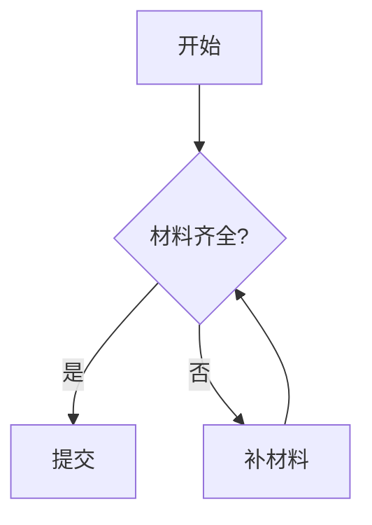

# 研究生事务服务平台 · 维护指引

这份文档给以后维护网站的人使用。

**一句话原则：只改 `网站改版2/内容/` 里的 Markdown 文件。**
其它所有东西 —— `index.html`、`pages/`、`data/`、`files/`、`assets/` —— 都是构建产物，
手动改了也会在下次构建时被覆盖。

---

## 一、目录分工：什么是源，什么是产物

| 路径 | 是什么 | 要不要手改 |
|---|---|---|
| `网站改版2/内容/` | **内容源**（Markdown） | ✅ **改这里** |
| `网站改版2/tools/` | 构建脚本（Python） | 一般不动 |
| `网站改版2/assets/` | CSS / JS | 改界面时才动 |
| `网站改版2/data/site-config.json` | 站点配置（站名、问卷星链接等） | 需要时改 |
| `index.html` `pages/` `data/` `files/` `assets/` | **构建产物** | ❌ 不要手改 |
| `网站内容信息/` | 原始材料包（已并入内容源） | ❌ 已废弃 |
| `网站改版/` | 旧版架构 | ❌ 已废弃 |

根目录的 `index.html` / `pages/` 等是 CI 从 `网站改版2/` 同步过来的，
和 `网站改版2/` 里的构建产物内容一致。两份都提交进 Git，方便本地直接预览。

---

## 二、日常改内容：三步走

### 第 1 步：找到并修改对应的 Markdown

```
网站改版2/内容/
├── 00_网站说明/        内部文档（不上线）
├── 01_首页/            首页文案
├── 02_新生专区/
├── 03_在校学习专区/    请假、选课、成绩、专利…
├── 04_奖助专区/        奖学金、助学金、助学贷款、困难认定
├── 05_党团专区/        党组织关系、团组织、党员发展、班委
├── 06_生活与证件专区/  宿舍、一卡通、网络、场地、医保、学生证
├── 07_实习就业与毕业专区/  实习、就业、升学、毕业、离校
├── 08_文件专区/        表格模板下载 + 附件原文
├── 09_问题专区/
├── 10_关于与联系/
└── 11_全局功能与维护/  内部文档
```

用记事本或 VS Code 打开直接改就行。

**常见改动对应写法：**

| 想做的事 | 怎么做 |
|---|---|
| 改标题、简介 | 改 md 开头 front-matter 里的 `title` / `desc` |
| 加搜索同义词 | 改 front-matter 里的 `keywords`（逗号分隔） |
| 新增一个子板块 | 建新 md，写好 `title` 和 `zone`，构建后自动出现在专区里 |
| 调整顺序 | 改 front-matter 里的 `order`（小的在前） |
| 链接附件 | md 里写 `[显示文字](<文件名.docx>)`，构建时自动匹配真实路径 |
| 标记待填内容 | 写 `【　】`，页面上渲染成橙色虚线框 |
| 插流程图 | 见下面第四节 |

### 第 2 步：本地预览（可选，但推荐）

```
双击 更新网站.bat
```

然后打开 `网站改版2/_preview/index.html` 看效果。
脚本会同时跑构建、页面检查和链接检查，有问题会直接报出来。

### 第 3 步：提交并推送

```bash
git add -A
git commit -m "更新：请假与考勤流程"
git push
```

**push 之后 GitHub Actions 自动做 4 件事：**

```
构建 → 链接检查 → 同步到站点根目录 → 提交产物
```

任何一步失败都会**中止**，不会把「半新半旧」的产物推到线上。

跑完 GitHub Pages 自动重新部署，**1–3 分钟**内线上生效。

**想看跑得怎么样**：到仓库的 **Actions** 页面看最新一次运行。
绿色对勾 = 成功；红色叉 = 失败，点进去能看到是哪一步、报了什么错。

---

## 三、front-matter 字段说明

Markdown 文件开头有一段配置：

```markdown
---
title: 请假与考勤
desc: 线下请假条与线上出省报备两条线、天数与审批级别
zone: study
anchor: leave
order: 1
keywords: 请假, 病假, 事假, 外出报备, 出省, 销假, 考勤
---

# 请假与考勤
...正文...
```

| 字段 | 必填 | 说明 |
|---|---|---|
| `title` | ✅ | 页面大标题，也是搜索索引的主键 |
| `desc` | | 一句话简介，显示在标题下方和专区卡片上 |
| `zone` | ✅ | 归属专区，见 `网站改版2/tools/siteconf.py` 的 `ZONES` |
| `anchor` | | URL 短名，不填则自动从 title 生成 |
| `order` | | 专区内排序，小的在前，默认 999 |
| `keywords` | | 额外搜索同义词，逗号分隔 |
| `internal` | | `true` = 内部文档，不上线、不进导航、不进搜索 |
| `updated` | | 最后更新日期（不填则自动取 git 提交日期） |

### 关于「最后更新」日期

页面底部会显示「最后更新：YYYY-MM-DD」。日期来源：

1. **front-matter 里写了 `updated`** —— 手动指定，优先级最高
2. **否则自动取这个 md 文件在 git 里最后一次被提交的日期**

所以**大多数情况不用管它** —— 改完 md 提交一次，日期自动更新。
只有「内容没变但要刷新日期」这类情况才需要手写 `updated`。

> 不用文件修改时间（mtime）：git clone / CI 检出时会把所有文件的 mtime
> 重置成「检出时刻」，全都会变成当天，显示出来的日期是假的。

`zone` 可选值：

```
freshman  新生专区
study    在校学习专区
aid      奖助专区
party    党团专区
life     生活与证件专区
career   实习就业与毕业专区
download 文件专区
faq      问题专区
about    关于与联系
```

---

## 四、流程图（Mermaid）

流程图直接写在 Markdown 正文里，用 Mermaid 代码块：

````markdown

````

构建时会自动渲染成流程图。

**之前流程图不显示，是因为**代码块里的内容被当成普通文字输出了。
现在 `md2html.py` 会在构建时调用 Mermaid 渲染，构建日志里也会报告
「渲染成功 / 渲染失败」。

---

## 五、附件怎么加

### 1. 把文件放进附件目录

```
网站改版2/内容/08_文件专区/附件/01_请假条与报备单/
```

按类别分文件夹放好。

### 2. 在 Markdown 里引用

写文件名就行，**不用写路径**：

````markdown
[请假条申请表（空表） 电院.doc](<请假条申请表（空表） 电院.doc>)
````

构建时自动在附件目录里按文件名匹配出真实路径并改写。
匹配不到会在构建日志里**报警告**，不会静默失败。

### 3. 附件会自动同步到两个地方

- `files/` —— 线上下载用的路径
- `网站改版2/files/` —— 本地预览用的路径

---

## 六、通知公告怎么维护

### 短通知：直接改 JSON

```
网站改版2/data/notices.json
```

```json
{
  "id": "2026103",
  "title": "这里写通知标题",
  "date": "2026-11-21",
  "summary": "这里写首页显示的简短摘要",
  "content": "这里写通知正文，可以先用普通文字。"
}
```

### 长通知：写 Markdown

在 `网站改版2/notices/` 里新建 `2026103.md`，然后在 `notices.json` 里加索引：

```json
{
  "id": "2026103",
  "title": "这里写通知标题",
  "date": "2026-11-21",
  "summary": "这里写首页显示的简短摘要",
  "markdown": "notices/2026103.md"
}
```

### 「重要通知」置顶

首页「重要通知」区第一项就是站点使用说明，这条是**固定**的。
新增通知时排在它后面即可。

---

## 七、搜索结果页

站内搜索现在有两级：

| 位置 | 行为 |
|---|---|
| 顶部搜索框（下拉） | 边打边出，**最多 6 条**，底部有「查看全部搜索结果」入口 |
| `pages/search.html?q=xxx` | **完整结果列表**，带关键词高亮、排序、相关搜索词 |

按回车会直接进结果页（不是跳第一条）—— 这样学生能看到全部匹配再挑。

### 搜索是怎么匹配的

按相关度依次判断，命中就收录：

1. 标题**完全相同** —— 最高分
2. 标题**开头**包含
3. 标题中间包含
4. 关键词包含
5. 简介包含
6. 拼音首字母（`qj` → 请假）
7. 拼音全拼（`qingjia` → 请假）

**「专区总览」页会被降权**（分数除以 3），排在具体页面后面 ——
学生搜「请假」要的是流程本身，不是专区目录。

### 拼音首字母只认开头

`initials` 是每个词的首字母拼起来的（用空格分隔），
比如「毕业设计」→ `bysj bs kt zqjc cz lw`。

匹配时**逐个词看开头，不把整串拍平**。否则会误命中：
拍平成 `bysjbsktzqjcczlw` 之后里面就有 `qj`（中期检查的 z**qj**c），
搜「请假」会把「毕业设计」也搜出来。

### 搜索词会被记录

学生在搜索框里输入的词会 POST 到 Worker 的 `/api/search`，
存进 D1 的 `search_logs` 表。**只存关键词，不存任何个人信息**，
IP 只存哈希。用于了解学生实际在搜什么。

查统计（需要管理员密钥）：

```bash
curl -H "Authorization: Bearer <ADMIN_KEY>" \
  "https://qiqida-stats-worker.dddhui-qi.workers.dev/api/search?days=30"
```

### Worker 地址在配置里

Worker 的 API 地址写在 `网站改版2/data/site-config.json` 的 `apiBase`：

```json
"apiBase": "https://qiqida-stats-worker.dddhui-qi.workers.dev/api"
```

JS 会自动读这个值。**国内访问 `workers.dev` 域名可能不稳定**（DNS 污染，
详见 `docs/网站使用与维护手册.md`），如果之后给 Worker 绑了自定义域名，
**只改这一处**就行，不用去各个 js 文件里翻着改。

---

## 八、结构化数据（JSON-LD）

每个页面都会自动生成 `<script type="application/ld+json">`，帮助搜索引擎
理解页面内容，进了富结果摘要（比如搜索结果里直接显示流程步骤）：

| 类型 | 出现在 | 来源 |
|---|---|---|
| `WebPage` | 所有页面 | 自动 |
| `WebSite` | 首页 | 自动 |
| `BreadcrumbList` | 子页面 | 自动（面包屑） |
| `HowTo` | 有流程图的页面 | **从 md 的 mermaid 图解析** |
| `FAQPage` | 有问答的页面 | **从 md 的「Q：… A：…」解析** |
| `SearchResultsPage` | 搜索结果页 | 自动 |

### 想让页面进 FAQ 摘要

在 md 里写成这样（**Q 和 A 必须是相邻的段落**）：

```markdown
**Q：学宿费怎么交？**
A：校园统一支付平台 http://hscwxf.scnu.edu.cn/ 或公众号「华南师范大学财务处」。
```

构建时自动收进 `FAQPage`，页面上也会正常显示。

### 想让页面进 HowTo 摘要

页面上有 ```mermaid flowchart``` 流程图就行，步骤自动从图里解析，
**不需要另外写一遍步骤**。

### 重要原则

结构化数据里的内容**必须页面上真的能看到**。搜索引擎会核对两者是否一致，
对不上会被判作弊，代价远大于收益。
所以解析不到就干脆不生成那个类型，不要手写假的。

---

## 九、站点配置

站名、问卷星反馈链接等全局配置：

```
网站改版2/data/site-config.json
```

改完跑一次构建即可生效。

---

## 十、上线前检查清单

每次发布前建议确认：

- 首页能打开，8 张专区卡片完整显示
- 搜索框能搜到常用关键词（试试「请假」「奖学金」「一卡通」）
- 搜索下拉底部有「查看全部搜索结果」入口，点击能进 `pages/search.html`
- 搜索结果页能列出全部匹配，命中词高亮正确
- 专区卡片点开能进专区页，再点子板块能进独立页
- 子页面面包屑、底部「上一个/下一个」和「← 返回XX专区」按钮正常
- 子页面底部有「最后更新：YYYY-MM-DD」
- 通知详情页能打开
- 下载按钮能下载到真实文件
- **手机端（390px 宽）**滚动首页不卡顿
- 页面底部有「返回顶部」文字链接

自动化检查：

```bash
python 网站改版2/tools/check.py       # 页面质量报告
python 网站改版2/tools/linkcheck.py    # 链接检查
node    网站改版2/tools/test-splash.js  # 引导页单元测试
```

---

## 十一、出问题了怎么办

### 看最近改了什么

```bash
git status              # 有哪些改动没提交
git log --oneline -10   # 最近 10 次提交
git diff                # 具体改了什么
```

### 常见问题

**CI 报「链接检查」失败**
说明有链接指向不存在的文件。报错信息里会写清楚是哪个页面的哪条链接，
去对应 md 里改掉。

**CI 报「构建失败」**
多半是 md 的 front-matter 写错了（比如 `zone:` 填了不存在的专区名）。
报错信息里有具体是哪个文件。

**线上没更新**
1. 先看 Actions 页面最新一次是不是绿的
2. 绿色的 —— 浏览器缓存，按 `Ctrl + F5` 强制刷新
3. 还是不对 —— 打开 https://qiqida.github.io/ 看是不是旧版本

**想回退到上一个版本**
```bash
git log --oneline -5
git reset --hard <commit>
git push --force origin main
```

**不确定怎么恢复**
不要急着执行 `reset`，把 `git status` 和 `git log` 的输出发出来一起判断。

---

## 十二、常见问题速查

| 现象 | 原因 | 怎么办 |
|---|---|---|
| 页面上的内容是旧版本 | 浏览器缓存 | `Ctrl + F5` |
| 改了 md 但线上没变 | 没 push / CI 失败了 | 检查 Actions 页面 |
| 改了 md 但线上没变 | 改的是构建产物目录 | 改 `网站改版2/内容/` 里的 md |
| 搜索搜不到新内容 | 缺 front-matter 的 `title` | 补上 `title` 和 `keywords` |
| 流程图显示成代码 | Mermaid 语法错 | 看构建日志里的渲染报错 |
| 附件链接点不开 | 文件名对不上 | 看构建日志里的附件匹配警告 |
| 想加一个新专区 | 要改构建脚本 | 见 `网站改版2/README.md` |

---

## 十三、主题与无障碍

- 日夜间模式偏好保存在浏览器 `localStorage`，刷新后仍有效
- 所有页面右下角有「回到顶部」按钮
- 站内搜索支持拼音首字母（如输入 `jx` 可搜「奖学金」）和全拼（`qingjia`）
- 全站支持键盘导航和 `Esc` 关闭弹层
