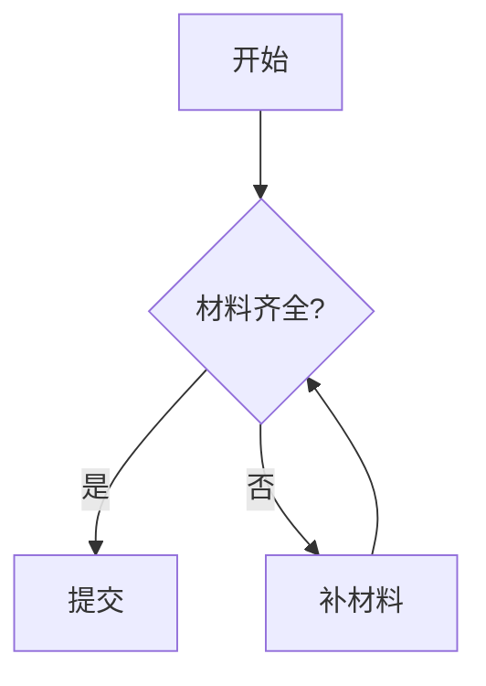

# 网站使用与维护手册

> 工学部研究生事务服务中心
> 线上地址：https://qiqida.github.io/
>
> 这份文档给两类人看：
> - **使用者** —— 看第一章「网站怎么用」
> - **维护者** —— 看第二章起「内容维护」「部署推送」「管理后台」

---

## 目录

**第一章 · 使用**
1. [网站怎么用](#一网站怎么用)
2. [八个专区速查](#二八个专区速查)
3. [站内搜索](#三站内搜索)
4. [文件下载](#四文件下载)
5. [留言反馈](#五留言反馈)

**第二章 · 内容维护**
6. [核心原则：只改内容文件夹](#六核心原则只改内容文件夹)
7. [目录结构](#七目录结构)
8. [改一个页面的完整流程](#八改一个页面的完整流程)
9. [front-matter 字段说明](#九front-matter-字段说明)
10. [附件怎么加](#十附件怎么加)
11. [通知公告怎么维护](#十一通知公告怎么维护)
12. [流程图怎么写](#十二流程图怎么写)
13. [待填写占位符](#十三待填写占位符)
14. [站点配置](#十四站点配置)

**第三章 · 部署推送**
15. [部署推送详细流程](#十五部署推送详细流程)
16. [CI 自动流程](#十六ci-自动流程)
17. [本地开发环境](#十七本地开发环境)
18. [常见故障排查](#十八常见故障排查)
19. [回退](#十九回退)

**第四章 · 管理后台**
20. [留言管理后台](#二十留言管理后台)
21. [Cloudflare Worker 运维](#二十一cloudflare-worker-运维)

**第五章 · 附录**
22. [常用命令速查](#二十二常用命令速查)
23. [文件位置速查](#二十三文件位置速查)

---

# 第一章 · 使用

## 一、网站怎么用

这个网站只做一件事：**告诉你某个手续怎么办**。

它**不受理申请**、不审批、不发当年通知。办手续仍要到学校系统或学院办公室；
当年的日期、名额、金额以学校与学院官方通知为准。

### 三步找到你要的东西

```
1. 搜索   →  在顶部搜索框输入你平时怎么叫这件事
             （「请假」「奖学金」「一卡通」「三方协议」……）
2. 找专区 →  搜索结果点进去，或从首页 8 张专区卡片进
3. 照做   →  每个流程页都写清：先做什么、再做什么、交什么材料
```

### 页面底部有什么

每个子板块页底部固定有：

| 元素 | 作用 |
|---|---|
| 「← 返回XX专区」 | 回到所属专区总览 |
| 「← 上一节 / 下一节 →」 | 按顺序看相邻内容 |
| 「返回顶部」 | 文字链接，不是按钮 |

---

## 二、八个专区速查

| 专区 | 管什么 | 常见事项 |
|---|---|---|
| **新生专区** | 从报到到上课 | 报到迎新、党团关系转接、入学教育体检、培养方案选课、导师双选、实验室安全考试 |
| **在校学习专区** | 请假、选课与成绩 | 请假考勤、选课退课、考试成绩、学籍异动、毕业设计、学术资源、专利软著、一站式申请 |
| **奖助专区** | 奖学金与助学金 | 奖学金、助学金与助学贷款、家庭经济困难认定、三助一辅岗位 |
| **党团专区** | 党组织与团组织 | 党组织关系转接、团组织关系与智慧团建、党员发展流程、班级与班委 |
| **生活与证件专区** | 住宿、校园卡与证明 | 宿舍报修退宿、一卡通补办、网络与账号、场地借用、心理咨询与医保、学生证补办、在读与成绩证明 |
| **实习就业与毕业专区** | 实习、就业到离校 | 实习申请与外出报备、实习证明、就业推荐与三方协议、升学与出国交流、毕业资格审核、学位申请与论文送审、毕业材料与档案、离校手续 |
| **文件专区** | 表格与模板下载 | 请假条与报备单、申请表与审批表、证明与协议模板、申请书与总结模板、附件与截图归档 |
| **问题专区** | 卡住了看这里 | 系统操作问题、材料与审核问题、流程卡点、找谁问与反馈 |

### 另有「关于与联系」专区

`about` 是第 9 个专区，包含：

| 子板块 | 内容 | 地址 |
|---|---|---|
| 网站说明与免责声明 | 本站定位、使用边界 | `pages/about-disclaimer.html` |
| 咨询方式与办公时间 | 找谁问、几点上班 | `pages/about-contact.html` |
| 办事地点指引 | 去哪个楼、哪间办公室 | `pages/about-place.html` |

它**不在首页的 8 张卡片区**，页脚也没放入口（按当前设计决定）。
`zone` 值写 `about`。

> ⚠️ **注意**：这 4 个页面目前**只能从搜索引擎或直接输网址进入**，
> 首页和页脚都没有指向它们的链接。页面之间的面包屑和上下页是通的，
> 所以从搜索引擎进来不会断路，但站内用户不容易发现。
>
> 想让它们可达，可以在页脚加一行链接，或在「问题专区 → 找谁问与反馈」
> 里链过去 —— 这属于改设计，需要先定方案。

---

## 三、站内搜索

### 支持的输入方式

| 输入 | 结果 |
|---|---|
| 中文词 | 「请假」「奖学金」「一卡通」 |
| 拼音首字母 | `jx` → 奖学金（需装了 `pypinyin`，没装不影响其它功能） |
| 拼音全拼 | `qingjia` → 请假 |
| 口语说法 | 「我要请假」「我想开在读证明」 |

搜索索引覆盖全部 61 个页面。找不到时可以去**问题专区**，
那里有「流程卡点」「找谁问与反馈」。

### 搜索结果页

首页搜索框下方下拉最多显示 6 条。想看全部结果：

- 点下拉底部的「**查看全部搜索结果 →**」，或
- 直接访问 `pages/search.html?q=请假`（`q` 后面是搜索词）

结果页做的事：

- 列出**全部**匹配结果，按相关度排序（标题命中排最前）
- 命中词**高亮**显示
- 搜不到时给出六个专区入口 + 「留言问我们」链接（点了直接弹出留言面板）
- 底部有「试试这些」相关词，点一下就换关键词

### 搜索词统计（后台可见）

学生搜的词会**匿名上报**到 Worker（同一个词 30 分钟内只报一次，不含任何个人信息）。
在 `admin/feedback.html` 登录后，切到「**搜索热词**」标签就能看到：

- 近 7 / 30 / 90 天的搜索词排行
- **站内搜不到的词会标红** —— 这些就是内容缺口，告诉你要补什么
- 也用来决定首页「常见搜索词」放哪几个词

> 上报失败不影响搜索功能（静默忽略）。

---

## 四、文件下载

「文件专区」按五类整理，共 28 个附件：

```
01_请假条与报备单
02_申请表与审批表
03_证明与协议模板
04_申请书与总结模板
05_说明与截图归档
```

点击即下载。**下载按钮只有在文件真实存在时才显示** ——
不会出现点了打不开的死链。

---

## 五、留言反馈

页面右下角有**留言反馈**按钮（手机上在左下角）。

- 姓名可选，留言内容必填，最多 500 字
- 提交后你会看到「留言提交成功」
- 管理员能在**留言管理后台**看到并处理

---

# 第二章 · 内容维护

## 六、核心原则：只改内容文件夹

> **只改 `网站改版2/内容/` 里的 Markdown 文件。
> 其它所有东西都是构建产物，手动改了也会在下次构建时被覆盖。**

这是整套流程的地基，弄清楚了以后维护这个站就是改记事本文件。

### 什么是「源」，什么是「产物」

| 路径 | 性质 | 要不要手改 |
|---|---|---|
| `网站改版2/内容/**/*.md` | **源** | ✅ **改这里** |
| `网站改版2/tools/*.py` | 构建脚本 | 一般不动 |
| `网站改版2/assets/**` | CSS / JS | 改界面时才动 |
| `网站改版2/data/site-config.json` | 站点配置 | 需要时改 |
| `网站改版2/data/notices.json` | 通知索引 | 加通知时改 |
| `网站改版2/pages/` `index.html` | 产物 | ❌ |
| 根目录 `pages/` `data/` `files/` `assets/` `index.html` | 产物（CI 同步过来的） | ❌ |

**根目录和 `网站改版2/` 里的产物内容一样**，只是根目录那份是线上直接用的。

### 为什么要分这么清

因为 CI 每次构建都会「先删后拷」重新生成产物目录。
如果你手动改了产物，下次构建**你的修改会消失**，而且不会有任何提示。

---

## 七、目录结构

```
网站改版2/内容/
├── 00_网站说明/        内部文档（internal: true，不上线）
│   ├── 01_网站定位与使用说明.md
│   ├── 02_流程指南模板.md
│   ├── 03_内容维护规范.md
│   └── 04_待填写占位清单.md      ← 自动生成，列出所有待填空位
├── 01_首页/            首页相关（品牌区、场景速查、第一次使用说明）
├── 02_新生专区/
├── 03_在校学习专区/
├── 04_奖助专区/
├── 05_党团专区/
├── 06_生活与证件专区/
├── 07_实习就业与毕业专区/
├── 08_文件专区/
│   ├── 01_请假条与报备单.md
│   ├── ...
│   ├── 05_附件与截图归档.md
│   └── 附件/                      ← 附件原文件放这里
│       ├── 01_请假条与报备单/
│       ├── 02_申请表与审批表/
│       └── ...
├── 09_问题专区/
├── 10_关于与联系/      ← 关于与联系专区（首页无入口，见第二章第一节）
└── 11_全局功能与维护/  内部文档
```

**编号顺序就是页面里的显示顺序**（配合 front-matter 的 `order` 字段）。

---

## 八、改一个页面的完整流程

### 场景：修改「请假与考勤」

**第 1 步 · 找到文件**

```
网站改版2/内容/03_在校学习专区/01_请假与考勤.md
```

用 VS Code 直接编辑（推荐，能看 markdown 预览），记事本也行。

**第 2 步 · 改内容**

```markdown
---
title: 请假与考勤
desc: 线下请假条与线上出省报备两条线、天数与审批级别
zone: study
order: 1
keywords: 请假, 病假, 事假, 外出报备, 出省, 销假, 考勤
---

# 请假与考勤

正文从这里开始……
```

**第 3 步 · 本地预览（可选但推荐）**

```
双击 更新网站.bat
```

会自动跑构建 + 质量检查 + 链接检查，然后打开预览页面。

预览入口：`网站改版2/_preview/index.html`

**第 4 步 · 提交推送**

```bash
git add -A
git commit -m "更新：请假与考勤流程"
git push
```

**第 5 步 · 等 CI**

push 后 GitHub Actions 自动构建部署，**1–3 分钟**后线上生效。

到仓库 **Actions** 页面看最新一次运行，绿色对勾 = 成功。

---

## 九、front-matter 字段说明

Markdown 文件开头有一段 `---` 包起来的配置：

```markdown
---
title: 请假与考勤
desc: 线下请假条与线上出省报备两条线、天数与审批级别
zone: study
anchor: leave
order: 1
keywords: 请假, 病假, 事假, 外出报备, 出省, 销假, 考勤
---

# 请假与考勤
```

| 字段 | 必填 | 说明 |
|---|---|---|
| `title` | ✅ | 页面大标题，也是搜索索引的主键 |
| `desc` | | 一句话简介，显示在标题下方和专区卡片上 |
| `zone` | ✅ | 归属专区，见下表 |
| `anchor` | | URL 短名，不填则自动从 title 生成 |
| `order` | | 专区内排序，小的在前，默认 999 |
| `keywords` | | 额外搜索同义词，逗号分隔 |
| `internal` | | `true` = 内部文档，**不上线**、不进导航、不进搜索 |
| `updated` | | 最后更新日期（`YYYY-MM-DD`），显示在页面底部 |

### `zone` 可选值

| 值 | 专区 | 值 | 专区 |
|---|---|---|---|
| `freshman` | 新生专区 | `life` | 生活与证件专区 |
| `study` | 在校学习专区 | `career` | 实习就业与毕业专区 |
| `aid` | 奖助专区 | `download` | 文件专区 |
| `party` | 党团专区 | `faq` | 问题专区 |
| `about` | 关于与联系 | `internal` | 内部文档（不上线） |

一共 10 个值，对应 `网站改版2/tools/siteconf.py` 里的 `ZONES` 表。

> ⚠️ 填错 `zone` 值会导致构建失败。报错信息里会写明是哪个文件。
> 注意是 `download` 和 `faq`，**不是** `files` 和 `problem`。

### 常用改动速查

| 想做的事 | 怎么做 |
|---|---|
| 改标题 / 简介 | 改 `title` / `desc` |
| 加搜索关键词 | 改 `keywords` |
| 新增一个子板块 | 建新 md，写好 `title` 和 `zone` |
| 调整子板块顺序 | 改 `order` |
| 让某页不显示 | 加 `internal: true` |
| 更新「最后更新」日期 | 改 `updated: 2026-11-23` |

> 💡 **不用手写 `updated`**：不填的话，构建时会自动从 Git 提交历史里取
> 这个文件最后一次被修改的日期。所以你只要正常 `git commit`，日期自动更新。

### 页面底部会多一行「最后更新」

每个子页面底部（上下页导航上方）会显示 `最后更新：2026-11-21` 这样的日期。
学生看到「这个流程最近改过」会放心一些，也方便你判断内容新不新。

---

## 十、附件怎么加

### 第 1 步 · 把文件放进附件目录

```
网站改版2/内容/08_文件专区/附件/02_申请表与审批表/
```

按类别分文件夹放好。

### 第 2 步 · 在 Markdown 里引用（只写文件名）

````markdown
[请假条申请表（空表） 电院.doc](<请假条申请表（空表） 电院.doc>)
````

**不用写路径。** 构建时自动在附件目录里按文件名匹配出真实路径并改写。

> 匹配不到会在构建日志里**报警告**，不会静默失败。
> 看到「附件匹配失败」就去核对文件名。

### 第 3 步 · 自动同步到两处

| 目标 | 用途 |
|---|---|
| `files/` | 线上下载用的路径 |
| `网站改版2/files/` | 本地预览用的路径 |

---

## 十一、通知公告怎么维护

### 短通知：直接改 JSON

```
网站改版2/data/notices.json
```

```json
{
  "id": "2026103",
  "title": "这里写通知标题",
  "date": "2026-11-21",
  "summary": "这里写首页显示的简短摘要",
  "pinned": false,
  "content": "这里写通知正文，可以先用普通文字。"
}
```

### 长通知：写 Markdown

1. 在 `网站改版2/notices/` 新建 `2026103.md`
2. 在 `notices.json` 里加索引：

```json
{
  "id": "2026103",
  "title": "这里写通知标题",
  "date": "2026-11-21",
  "summary": "这里写首页显示的简短摘要",
  "pinned": false,
  "markdown": "notices/2026103.md"
}
```

### 置顶通知

`"pinned": true` 的通知会排在首页「重要通知」区最前面。
当前置顶的是「这个网站怎么用」，是固定条目。

### 改完别忘了

通知有独立详情页，构建时会自动生成 `pages/notice-2026103.html`，
不需要手动建。

---

## 十二、流程图怎么写

用 Mermaid 代码块，直接写在 Markdown 正文里：

````markdown

````

构建时自动渲染成流程图。渲染失败会在构建日志里报错。

> 之前流程图不显示，是因为代码块内容被当成普通文字输出了。
> 现在 `md2html.py` 会在构建时调用 Mermaid 渲染，并报告成功/失败。

---

## 十三、待填写占位符

### 怎么表示「这块还没定」

写 `【　】`（全角方括号加空格），页面会渲染成**橙色虚线框**：

```
入口（网址、小程序或企业微信路径）：【　】
```

### 填完怎么算

**把括号删掉**，内容变成正常文字，虚线框自动消失。

### 怎么查还有哪些没填

```bash
python 网站改版2/tools/placeholders.py   # 按文件分组列出所有空位
python 网站改版2/tools/fillcheck.py      # 生成可直接对照填的清单（推荐）
```

两个脚本的区别：

| | `placeholders.py` | `fillcheck.py` |
|---|---|---|
| 输出 | `04_待填写占位清单.md` | `05_待填写清单（可直接对照填）.md` |
| 每条空位 | 单独一行 | 独立一条，**带编号**（S001、S002…） |
| 有字段名吗 | ❌ 只抄原文那行 | ✅ 提取「要填什么」 |
| 表格行 | 拆成 N 条，没法填 | ✅ 整行算 1 条，标出列名 |
| 适合 | 快速看还剩多少 | **照着填** |

`fillcheck.py` 生成的清单长这样：

```
**S029**
- 所属小节：二、线上请假（教学期间出省报备）
- 要填什么：线上请假的系统 / 入口（网址、小程序或企业微信路径）
- 位置：第 86 行
```

**你只需要按编号回内容**，比如「S029：企业微信 → 学生服务 → 出省报备」，
我按现有对外口吻写回对应 md。

**当前状态：230 处待填，分布在 42 个文件。**

### 建议的填写顺序

| 顺序 | 文件 | 原因 |
|---|---|---|
| 1 | `09_问题专区/04_找谁问与反馈.md` | 18 处，联系信息是最高频需求 |
| 2 | `03_在校学习专区/01_请假与考勤.md` | 13 处，线上请假入口 |
| 3 | `10_关于与联系/02_咨询方式与办公时间.md` | 7 处 |
| 4 | `10_关于与联系/03_办事地点指引.md` | 5 处 |
| 5 | 各页「需要你填写」 | 导师双选、党员发展、答辩、场地借用等本院具体流程 |
| 6 | `08_文件专区` 各索引页 | 缺原件的模板 |

> 填写时**不要写具体年份、金额、名额**。本站只写每年都差不多的固定流程，
> 写死具体数字反而容易过期误导。

---

## 十四、站点配置

```
网站改版2/data/site-config.json
```

| 字段 | 说明 |
|---|---|
| `siteName` | 站点名称 |
| `gaId` | Google Analytics 测量 ID（当前 `G-2S0K5DDSME`） |
| `feedbackUrl` | 问卷星链接。**留空或保持示例地址时，「打开问卷星」按钮自动隐藏** |
| `feedbackNote` | 问卷星入口的提示文字 |
| `giscusRepo` 等 | 评论功能配置，当前为空（未启用） |

改完跑一次构建即可生效。

---

# 第三章 · 部署推送

## 十五、部署推送详细流程

### 完整流程图

```
  改 md 文件
      ↓
  git add / commit / push
      ↓
  GitHub Actions 触发
      ↓
  ┌─────────────────────────────────────┐
  │ 1. 构建（make.py）                   │
  │    build.py → assets.py → notices.py │
  │    → home.py → seo.py → preview.py   │
  │    → check.py                       │
  └─────────────────────────────────────┘
      ↓ 失败则中止
  ┌─────────────────────────────────────┐
  │ 2. 链接检查（linkcheck.py）          │
  │    检查全部页面 + 949 条链接         │
  └─────────────────────────────────────┘
      ↓ 失败则中止
  ┌─────────────────────────────────────┐
  │ 3. 同步到站点根目录（deploy.py）     │
  │    先删后拷 + 生成 6 个旧链接跳转页  │
  └─────────────────────────────────────┘
      ↓
  ┌─────────────────────────────────────┐
  │ 4. 提交产物（[skip ci]，不循环）     │
  └─────────────────────────────────────┘
      ↓
  GitHub Pages 自动重新部署
      ↓
  线上更新（1–3 分钟）
```

**任何一步失败都会中止**，不会把「半新半旧」的产物推到线上。

### 第 1 步：本地预览

```
双击 更新网站.bat
```

脚本会依次做：

1. 检查 Python 是否可用（没有会给出安装提示）
2. 跑 `make.py` 完整构建
3. 构建失败会**停下来报错**，不会继续
4. 构建成功则打开预览页（带时间戳参数，绕开浏览器缓存）

预览入口：`网站改版2/_preview/index.html`

### 第 2 步：提交并推送

```bash
git status                    # 确认改了哪些
git add -A
git commit -m "更新：请假与考勤流程"
git push
```

> ⚠️ **只提交源文件**。如果你本地跑过 `deploy.py`，根目录的 `pages/` `assets/`
> 等产物会有本地差异（SITE_VER 时间戳不同）。这些**不要提交**，
> 交给 CI 重新生成，否则会产生 rebase 冲突。

正确的做法：

```bash
git add -- "网站改版2" "docs" "README.md"
```

### 第 3 步：确认 CI 跑成功

到仓库 **Actions** 页面看最新一次运行：

| 图标 | 含义 | 该做什么 |
|---|---|---|
| ✅ 绿色对勾 | 成功 | 等 Pages 部署完即可 |
| ❌ 红色叉 | 失败 | 点进去看哪一步失败、报了什么错 |
| ⏳ 黄色转圈 | 运行中 | 等 |

也可以命令行查（需要装 `gh`）：

```bash
gh run list --limit 3
gh run view <run-id> --log
```

没有 `gh` 就直接看网页。

### 第 4 步：等 Pages 部署

`Build Site` 成功后，GitHub 还会自动跑一个 `pages build and deployment`。
那个也变绿，线上才真正更新。

**总耗时通常 1–3 分钟。**

### 第 5 步：验证

```bash
# 本地看文件对不对
curl -s https://qiqida.github.io/assets/css/v8-components.css | head -20

# 本地跑完整链接检查
python 网站改版2/tools/linkcheck.py
```

浏览器上记得**强制刷新**（`Ctrl + F5`）清掉旧 CSS/JS 缓存。

### 哪些改动会触发 CI

| 改了 | 触发 |
|---|---|
| `网站改版2/内容/**/*.md` | ✅ |
| `网站改版2/tools/*.py` | ✅ |
| `网站改版2/assets/**` | ✅ |
| `网站改版2/data/site-config.json` | ✅ |
| `worker/**` | ✅（触发 Worker 部署，另一个工作流） |
| `.github/workflows/*.yml` | ✅ |
| 只改了 `README.md` / `docs/` | ❌ 不会（也不需要） |
| 本地跑构建但没 push | ❌ 不会 |

---

## 十六、CI 自动流程

### 工作流文件

| 文件 | 作用 | 触发条件 |
|---|---|---|
| `.github/workflows/build-site.yml` | 构建站点 + 同步 + 部署 Pages | `网站改版2/**`、`网站内容信息/**`、workflow 本身 |
| `.github/workflows/deploy-worker.yml` | 部署 Cloudflare Worker | `worker/**` |

### build-site.yml 关键步骤

```yaml
- name: 全量构建
  run: python 网站改版2/tools/make.py

- name: 链接检查
  run: python 网站改版2/tools/linkcheck.py

- name: 同步到站点根目录
  run: python 网站改版2/tools/deploy.py

- name: 提交构建产物
  run: |
    git add -A index.html pages data files notices assets sitemap.xml robots.txt 404.html
    git diff --staged --quiet || git commit -m "build: 同步站点内容 [skip ci]"
    git push
```

> `[skip ci]` 标记让这次提交**不再触发** CI，避免无限循环。

### 同步逻辑（deploy.py）

**「先删后拷」**：

| 目录 | 处理 |
|---|---|
| `pages/` `data/` `files/` `notices/` `assets/` | 整体清空 → 复制新产物 |
| `index.html` `sitemap.xml` `robots.txt` `404.html` | 直接覆盖 |

清空是为了避免上一版的旧文件残留成死链或垃圾。

### 旧链接保护

别人收藏过的旧链接不会失效，`deploy.py` 自动生成跳转页：

| 旧地址 | 跳到 |
|---|---|
| `pages/leave.html` | `pages/study-leave.html` |
| `pages/internship.html` | `pages/career-internship.html` |
| `pages/graduation.html` | `pages/career-degree.html` |
| `pages/other.html` | `pages/life.html` |
| `pages/notices.html` | `pages/about-disclaimer.html` |
| `pages/notice.html` | `pages/notice-2026100.html` |

### SITE_VER 缓存机制

每次构建生成一个时间戳版本号，通过环境变量传给所有构建脚本，
写进 HTML/JS 的资源引用：

```html
<link rel="stylesheet" href="assets/css/style.css?v=1795270409">
```

同时所有 `fetch()` 也带同一版本号：

```javascript
fetch("data/site-config.json?v=" + (window.SITE_VER || "1"))
```

**作用**：内容改了以后浏览器不会拿旧缓存。

> 一次性构建里所有脚本共用同一个版本号（`make.py` 通过环境变量传递），
> 保证首页和子页面引用的是同一批资源。

---

## 十七、本地开发环境

### 需要什么

| 工具 | 版本 | 必需？ |
|---|---|---|
| Python | 3.8+ | ✅ 必需 |
| `pypinyin` | 任意 | ❌ 可选，装了支持拼音首字母搜索 |
| Node.js | 20 | ❌ 只改 Worker 时需要 |
| Git | 任意 | ✅ 必需 |

装 `pypinyin`：

```bash
pip install pypinyin
```

### 目录用途

| 目录 | 说明 |
|---|---|
| `网站改版2/_preview/` | 本地预览站点，**gitignore 了**，不要提交 |
| `网站改版2/tools/` | 构建脚本 |
| `网站改版2/内容/` | 内容源 |
| `worker/` | Cloudflare Worker 源码 |

---

## 十八、常见故障排查

### CI 报「链接检查」失败

**症状**：CI 第二步失败。

**原因**：有链接指向不存在的文件。

**处理**：报错信息里会写清楚是哪个页面的哪条链接，去对应 md 改掉。

```bash
python 网站改版2/tools/linkcheck.py   # 本地复现
```

### CI 报「构建失败」

**症状**：CI 第一步失败。

**常见原因**：

| 原因 | 表现 |
|---|---|
| front-matter 写错 | 报错里有具体文件名 |
| `zone` 值不存在 | 报错提示未知 zone |
| Markdown 语法错误 | 报错指到行号 |
| 附件文件名对不上 | 警告「附件匹配失败」 |

**处理**：按报错信息改对应 md。

### 线上没更新

按顺序排查：

1. **Actions 页面最新一次是绿的吗？**
   - 红 → 看第 1、2 条
   - 灰/黄 → 还在跑，等
2. **绿的话，清浏览器缓存** —— `Ctrl + F5`
3. **还是旧版本？** 打开 https://qiqida.github.io/ 看是不是旧版本

可能原因：Pages 部署那一步还没完成（`Build Site` 绿了但 `pages build and deployment` 还在跑）。

### push 被拒绝（rejected）

**症状**：

```
! [rejected] main -> main (fetch first)
```

**原因**：远端有 CI 推的产物提交，本地没有。

**处理**：

```bash
git pull --rebase origin main
# 解决冲突后
git push
```

> ⚠️ 冲突多半出现在根目录的 `pages/` `assets/` —— 那是产物。
> 正确解法是**放弃本地产物改动**，让 CI 重新生成：
>
> ```bash
> git checkout --theirs pages/ assets/ index.html
> git add pages assets index.html
> git rebase --continue
> ```
>
> 或者干脆：`git rebase --abort`，然后**只提交源文件**重来（见第十五步）。

### 手机端卡顿

之前遇到过「常见搜索词」滚动卡顿 —— 39 个标签同时做 `backdrop-filter: blur()`，
手机 GPU 吃不消。

修复方式：在 `v8-components.css` 里对触屏设备关掉标签的毛玻璃，
只保留外层卡片一层。**滚动流内毛玻璃元素从 40 个降到 1 个。**

```css
@media (hover: none), (any-pointer: coarse) {
    .search-tag {
        backdrop-filter: none;
        -webkit-backdrop-filter: none;
        background: rgba(255, 255, 255, 0.92);
    }
    .search-card {
        backdrop-filter: blur(12px);
        -webkit-backdrop-filter: blur(12px);
    }
}
```

> ⚠️ 这段必须放在 `.search-tag` 定义**之后**。
> `v8-components.css` 加载在 `touch-feedback.css` 之后，同特异性时靠后的胜出。

### 其它

| 现象 | 原因 | 怎么办 |
|---|---|---|
| 页面内容是旧的 | 浏览器缓存 | `Ctrl + F5` |
| 改了 md 但线上没变 | 没 push / CI 失败 | 看 Actions |
| 改了 md 但线上没变 | 改的是产物目录 | 改 `内容/` 里的 md |
| 搜索搜不到新内容 | 缺 `title` / `keywords` | 补 front-matter |
| 流程图显示成代码 | Mermaid 语法错 | 看构建日志 |
| 附件点不开 | 文件名对不上 | 看构建日志的匹配警告 |

---

## 十九、回退

### 回退到上一个版本

```bash
git log --oneline -5              # 找到要回退到的 commit
git reset --hard <commit>         # 本地回退
git push --force origin main      # 推上去
```

### 只回退某几个文件

```bash
git checkout <commit> -- 网站改版2/内容/03_在校学习专区/01_请假与考勤.md
git commit -m "回退：请假与考勤"
git push
```

### 不确定怎么恢复

**不要急着执行 `reset`**，把下面两条的输出发出来一起判断：

```bash
git status
git log --oneline -10
```

---

# 第四章 · 管理后台

## 二十、留言管理后台

### 访问地址

```
https://qiqida.github.io/admin/feedback.html
```

> ⚠️ **这个页面是公开的**（任何人都能打开登录界面）。
> 但**数据受密钥保护** —— 没有正确的 `ADMIN_KEY` 拿不到任何留言。
> 这层保护在 Worker 端做，不是靠隐藏页面。

### 登录

1. 打开上面的地址
2. 输入**管理员密钥**
3. 点「登录」

密钥保存在浏览器 `localStorage`，下次打开自动登录。
右上角「退出登录」会清除。

> 如果密钥填错，会显示「密钥无效」；
> 如果密钥过期（被改过），会自动登出并提示「登录已过期」。

### 界面功能

| 区域 | 功能 |
|---|---|
| 顶部标签 | 两个视图：**留言** / **搜索热词** |
| 状态筛选 | 按状态筛选：**待处理 / 已通过 / 已拒绝 / 全部**，各带数量角标 |
| 留言卡片 | 显示姓名（或「匿名用户」）、时间、状态、正文 |
| 查看详情 | 弹窗看完整信息（ID、姓名、状态、时间、正文） |
| 通过 | 把留言状态改成 `approved` |
| 拒绝 | 把留言状态改成 `rejected` |
| 底部翻页 | 每页 20 条，可翻页 |

### 搜索热词视图

切到「**搜索热词**」标签可以看到学生实际在搜什么：

| 区域 | 功能 |
|---|---|
| 时间范围 | 近 7 天 / 近 30 天 / 近 90 天 |
| 汇总行 | 一共多少个搜索词、多少次搜索、有几个词站内搜不到 |
| 词条 | 词 + 搜索次数 + 最后搜索时间 |

**标红的词 = 站内搜不到这个内容**。这是最有价值的信号 ——
说明学生有这个需求但内容还没写。补上内容后，词会变回正常颜色。

用这个视图决定首页「常见搜索词」放哪几个词（那些搜得多、而且站内确实有对应页面的）。

> 搜索词是**匿名**上报的，只有关键词本身，不含任何个人信息。

### 状态流转

```
   提交留言
      ↓
  [待处理]  ←→  通过 →  [已通过]
      ↓
   拒绝 →  [已拒绝]
```

### 密钥怎么设

在 Cloudflare Dashboard → Workers & Pages → 你的 Worker →
Settings → Variables and Secrets → 添加 secret：

| 名称 | 值 | 类型 |
|---|---|---|
| `ADMIN_KEY` | 你自己定的密钥字符串 | **Secret**（加密） |

**不要**写进 `wrangler.toml` 的 `[vars]` 里 —— 那个是明文提交到 Git 的。

### 部署管理后台页面

`admin/feedback.html` 是纯静态页面，**不走 CI**（`_config.yml` 里排除了 `admin/`）。
改完直接提交到 `main` 分支就生效，Pages 会自动发布。

---

## 二十一、Cloudflare Worker 运维

### Worker 做什么

```
worker/src/index.ts
```

| 路由 | 方法 | 作用 | 需要密钥 |
|---|---|---|---|
| `/api/feedback` | POST | 提交留言 | ❌ |
| `/api/feedback` | GET | 查询留言 | ✅ |
| `/api/feedback/update` | POST | 改留言状态 | ✅ |
| `/api/stats` | GET | GA 统计 | ❌ |

### 数据存哪

Cloudflare **D1** 数据库 `feedback_db`：

| 表 | 字段 |
|---|---|
| `messages` | `id`（自增）、`name`、`content`、`ip_hash`、`user_agent`、`created_at`、`status` |

- `ip_hash` —— IP **哈希**后存储，不存明文 IP
- `status` —— `pending` / `approved` / `rejected`（数据库层面有 CHECK 约束）
- 有 `status` 和 `created_at` 两个索引

建表语句在 `worker/migrations/0001_create_messages.sql`。

### 改 Worker 的流程

```bash
# 1. 改代码
#    编辑 worker/src/index.ts

# 2. 本地试
cd worker
npm install
npm run dev

# 3. 提交推送（CI 会自动部署）
cd ..
git add worker
git commit -m "feat: worker 新功能"
git push
```

`.github/workflows/deploy-worker.yml` 会在 `worker/**` 变化时自动跑 `wrangler deploy`。

> 需要仓库里配置两个 secret：
> - `CLOUDFLARE_API_TOKEN`
> - `CLOUDFLARE_ACCOUNT_ID`

### 手动部署

```bash
cd worker
npm run deploy
```

### ⚠️ 已知问题：国内访问 workers.dev 不稳定

**现象**：`qiqida-stats-worker.dddhui-qi.workers.dev` 域名解析到错误的 IP，
连接超时，留言提交失败（前端提示「网络错误，请稍后重试」）。

**原因**：`workers.dev` 域名在部分网络环境下被 DNS 污染或屏蔽。

**影响范围**：

| 功能 | 受影响？ |
|---|---|
| 首页数据统计 | ❌ 不受影响（走本地静态 JSON `data/site-stats.json`） |
| 站内搜索 | ❌ 不受影响（走本地静态 JSON） |
| 文件下载 | ❌ 不受影响 |
| **留言提交** | ✅ **受影响** |
| **留言管理后台** | ✅ **受影响** |

**解决办法**（按推荐度）：

1. **给 Worker 绑定自定义域名**（推荐）
   Cloudflare 有自己的域名的话，绑一个 `feedback.你的域名`，
   走 CNAME 不受 `workers.dev` 污染影响。
   改完后要同步更新三处：
   - `网站改版2/assets/js/feedback-float.js` 里的 `apiUrl`
   - `admin/feedback.html` 里的 `API_BASE`
   - `网站改版2/tools/siteconf.py` 里的 `SCENARIOS` 无关，实际不用改

2. **换用问卷星**
   `data/site-config.json` 的 `feedbackUrl` 填真实问卷星地址，
   留言面板里会显示「打开问卷星」按钮。问卷星是国内服务，稳定性好。

3. **暂时不管** —— 留言是次要功能，站内搜索和流程查询是主要用途。

---

# 第五章 · 附录

## 二十二、常用命令速查

### 内容维护

```bash
# 全量构建（含质量检查）
python 网站改版2/tools/make.py

# 单独跑某一步
python 网站改版2/tools/build.py       # 生成专区页面
python 网站改版2/tools/assets.py      # 迁移附件 + 生成 data/
python 网站改版2/tools/notices.py     # 生成通知详情页
python 网站改版2/tools/home.py        # 生成首页
python 网站改版2/tools/searchpage.py  # 生成搜索结果页
python 网站改版2/tools/seo.py         # 生成 sitemap / robots / 404
python 网站改版2/tools/preview.py     # 生成预览站点
```

### 检查

```bash
python 网站改版2/tools/check.py         # 页面质量报告
python 网站改版2/tools/linkcheck.py     # 链接检查（约 1150 条）
python 网站改版2/tools/check-jsonld.py  # 校验结构化数据（JSON-LD）合法性
    python 网站改版2/tools/placeholders.py  # 列出待填的【　】
python 网站改版2/tools/fillcheck.py    # 生成可对照填的清单（带编号和字段名）
```

### 部署

```bash
python 网站改版2/tools/deploy.py       # 手动同步到根目录（跑完记得 git status）
```

### Git

```bash
git status
git log --oneline -10
git diff
git add -- "网站改版2" "docs" "README.md"   # 只加源文件
git commit -m "说明"
git push
```

### Worker

```bash
cd worker
npm run dev        # 本地调试
npm run deploy     # 手动部署
```

### 其它

```bash
# 只提交源文件（避免 rebase 冲突）
git add -- "网站改版2" "docs" "README.md"

# 放弃本地产物改动
git checkout -- pages/ assets/ index.html

# 强制刷新浏览器缓存
# Ctrl + F5
```

---

## 二十三、文件位置速查

### 内容

| 想改什么 | 去哪 |
|---|---|
| 某个流程页的正文 | `网站改版2/内容/<专区>/<编号>_<名称>.md` |
| 搜索关键词、标题、简介 | 对应 md 的 front-matter |
| 新增子板块 | `网站改版2/内容/<专区>/` 建新 md |
| 附件原文件 | `网站改版2/内容/08_文件专区/附件/` |
| 通知 | `网站改版2/data/notices.json` + `网站改版2/notices/` |
| 站名 / 问卷星 / GA | `网站改版2/data/site-config.json` |
| 待填空位清单 | `网站改版2/内容/00_网站说明/04_待填写占位清单.md` |

### 界面

| 想改什么 | 去哪 |
|---|---|
| 样式 | `网站改版2/assets/css/*.css` |
| 首页结构 | `网站改版2/tools/home.py` |
| 专区名称 / 简介 | `网站改版2/tools/siteconf.py` 的 `ZONES` |
| 常用事务入口 | `网站改版2/tools/siteconf.py` 的 `SCENARIOS` |
| Markdown 渲染 | `网站改版2/tools/md2html.py` |
| 搜索功能 | `网站改版2/assets/js/search.js` |
| 留言面板 | `网站改版2/assets/js/feedback-float.js` |
| 管理后台页面 | `admin/feedback.html` |

### 部署

| 想改什么 | 去哪 |
|---|---|
| CI 构建流程 | `.github/workflows/build-site.yml` |
| CI Worker 部署 | `.github/workflows/deploy-worker.yml` |
| Jekyll 排除配置 | `_config.yml` |
| Worker 源码 | `worker/src/index.ts` |
| Worker 配置 | `worker/wrangler.toml` |
| Worker 数据库 | `worker/migrations/*.sql` |
| 站点根目录同步逻辑 | `网站改版2/tools/deploy.py` |
| 构建入口 | `网站改版2/tools/make.py` |

---

## 附：技术栈

| 项 | 说明 |
|---|---|
| 形态 | 纯静态站点，无运行时依赖 |
| 内容 | Markdown + front-matter |
| 构建 | Python 3.8+，7 个脚本串联 |
| 部署 | GitHub Actions → GitHub Pages（`.nojekyll` 跳过 Jekyll） |
| 后端 | Cloudflare Worker + D1（仅留言功能） |
| 统计 | Google Analytics（`G-2S0K5DDSME`） |
| 搜索 | 前端模糊匹配 + 拼音首字母（可选依赖 `pypinyin`） |
| 流程图 | Mermaid，构建时渲染 |
| 主题 | 深色模式，偏好存 `localStorage` |

---

*文档版本：2026-11-22*
*线上站点：https://qiqida.github.io/*
