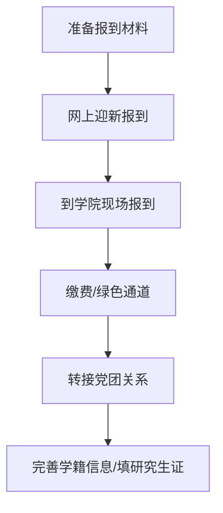

# 报到与迎新

从收到录取通知到正式上课。以下按学院现行做法整理；线上网站若与本页不一致，以本页为准。`【　】` 为待填写项。

## 迎新系统与现场报到

报到前先把该交的材料准备齐，按流程走完注册、缴费、党团关系转接，就算正式入学了。

### 报到流程

### 报到当天要带的东西

- 研究生录取通知书原件、身份证原件
- 本科毕业证复印件 1 份（应届硕士生，验原件）
- 户口迁移证原件 + 复印件（不迁户口的不用交）
- 党（团）组织关系介绍信
- 小一寸免冠彩色照片若干（办各种证用）
- 生源地贷款回执（办了贷款的同学）

详细的材料清单和现场安排，看下面的《研究生报到流程（新生版）》。

### 缴费怎么交

两个渠道，选一个就行：

1. 校园统一支付平台：http://hscwxf.scnu.edu.cn/
2. 微信公众号「**华南师范大学财务处**」（微信号 scnu_cwc）→ 智能财务 → 统一支付

> 关注「华南师范大学财务处」公众号可以查缴费通知和缴费指南。

**提醒**：没缴清学宿费会影响成绩录入、毕业资格审核和论文答辩，别拖。

### 报到后要做的事

- 完善学籍信息、填好研究生证——具体填写要求见本文件夹的《新生完善学籍信息、研究生证填写指南》。
- 学院要求信息填**全称**：电子科学与工程学院（微电子学院）。
- 办理银行卡登记（发奖助学金用）。

### 相关文件内容

- [研究生报到流程（新生版）](<../08_文件专区/附件/05_说明与截图归档/研究生报到流程（新生版） 电院.pdf>)
  - 报到时间地点：2026 年 9 月 6 日 8:00—17:00，佛山校区行政楼二楼 211。
  - 列了当天要带的材料清单：录取通知书、身份证、毕业证、户口迁移材料、党（团）组织关系介绍信、小一寸照片、贷款回执等。
  - 附了企业微信找迎新报到码的指引、东南门和北门路线图、紫荆探园小程序使用说明，以及绿色通道说明。
- [新生完善学籍信息、研究生证填写指南](<../08_文件专区/附件/05_说明与截图归档/新生完善学籍信息、研究生证填写指南 电院.doc>)
  - 学籍信息：登录研究生管理信息系统（https://gs.scnu.edu.cn/），账号是学号，原始密码是身份证后 8 位；在「我的学籍」里逐项完善并保存。
  - 姓名拼音格式有例子：姓在前、名在后、首字母大写，比如 Yang Li、Lyu Weimin、Ouyang Wen；港澳台生和留学生按证件上的英文写。
  - 研究生证填写：入学日期统一写 2026 年 9 月 6 日；出生年月用 2004.08.05 这种格式；学院写全称「电子科学与工程学院（微电子学院）」；乘车区间校区所在地填「佛山」。

## 新生资料下载

新生常用的资料汇总，点开即可下载。

### 相关文件内容

- [研究生报到流程（新生版）](<../08_文件专区/附件/05_说明与截图归档/研究生报到流程（新生版） 电院.pdf>)
  - 写了 2026 年 9 月 6 日报到的时间地点、要带的材料清单、迎新报到码怎么找、校园路线和绿色通道说明。
- [新生完善学籍信息、研究生证填写指南](<../08_文件专区/附件/05_说明与截图归档/新生完善学籍信息、研究生证填写指南 电院.doc>)
  - 写了怎么登录研究生管理信息系统完善学籍、姓名拼音怎么写、研究生证各栏怎么填（入学日期 2026 年 9 月 6 日，学院写全称，乘车区间填佛山）。

## 需要你填写

- 其他新生资料（培养方案、入学教育材料等）的文件名与链接：【　】
