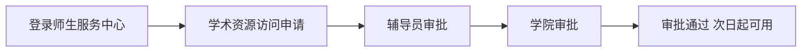

# 学术资源使用

学校提供学术论文、科技搜索等科研学术网站的专项访问服务（校内有专属通道，不用自己想办法）。要用先申请，申请通过后按下面的方法访问。

## 怎么申请

- 入口：师生服务中心 https://service.scnu.edu.cn/ →「学术资源访问申请」
- 本科生、研究生申请：辅导员审批 → 所在学院审批
- 教职工申请：所在学院领导审批
- 申请通过后，**次日起**就能用

## 怎么访问

1. 用本人的校园网账号（就是一卡通卡号）连接校园网。
2. 打开 https://scholar.edu.cn/ ，在页面上方「浏览器及工具下载」下载并安装对应型号的 **Open 浏览器**。
3. 装好后打开 Open 浏览器，再访问 https://scholar.edu.cn/ ，点相应链接就能进入学术资源网站。**必须通过 Open 浏览器访问，普通浏览器打不开。**
4. 要用 git 的话，参考页面「学术工具」里的说明。
5. 使用中遇到问题，在首页「需求及问题反馈」栏填写建议。

## 几条红线

1. **严禁翻墙**——校园网翻墙属违规，学术资源走学校提供的正规通道。
2. **账号不外借**——学术资源访问权严禁转让、出借，违规会被取消使用权限。
3. 使用时不能发布违法、扰乱社会稳定、影响学校声誉的信息。

## 校园网账号

- 无线网信号 SCNUNET，教学楼、办公楼、图书馆、宿舍都有覆盖。
- 账号是学号，初始密码身份证后八位（字母大写）。
- 一个账号最多同时登录 3 台设备。

## 相关文件内容

- [附件1 华南师范大学学术资源服务使用手册](<../08_文件专区/附件/05_说明与截图归档/附件1华南师范大学学术资源服务使用手册.docx>)
  - 写怎么申请：师生服务中心 →「学术资源访问申请」，本科生/研究生由辅导员和学院审批，教职工由学院领导审批。
  - 写怎么访问：审批通过次日起，用一卡通账号连校园网，打开 https://scholar.edu.cn/ 下载安装 Open 浏览器，再用这个浏览器访问学术资源网站。
  - 还提到 git 等学术工具的使用说明，以及首页「需求及问题反馈」的用法。
- [附件2 学术资源服务管理办法（试行）](<../08_文件专区/附件/05_说明与截图归档/附件2 学术资源服务管理办法.docx>)
  - 总则部分说明学术资源服务是什么、为什么要管、谁来负责；原则是「谁使用谁负责，谁主管谁负责」。
  - 开通流程部分写学校怎么获得权限、校内用户怎么申请、人员变动怎么更新或撤销权限。
  - 安全与合规部分写账号仅限本人使用、不得转让出借，网络信息中心负责技术支持和访问日志留存。

## 相关链接

- 师生服务中心（申请入口）：https://service.scnu.edu.cn/
- 学术资源访问：https://scholar.edu.cn/
- 公众号：华南师大图书馆（数据库资源、座位预约）；图书馆官网 http://lib.scnu.edu.cn/
- 网络信息中心：https://nc.scnu.edu.cn/

## 找谁问

网络信息中心；图书馆
