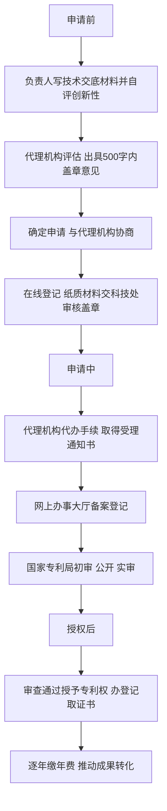

# 专利与软件著作权申请

有个重要原则：**要发表论文或公开技术要点之前，先想清楚要不要申请专利**。一旦公开，就丧失新颖性，专利可能申请不下来。

## 申请入口

学校综合服务平台 https://sso.scnu.edu.cn → 科研创新服务管理平台 → 专利申请 / 软件著作权申请，可以在线查看和下载申请流程。

## 专利管理流程

> 上图为学校专利管理的完整流程图，与本文放在同一个文件夹，可直接放到网站对应位置。

## 相关文件内容

- [华南师范大学专利管理流程图](<../08_文件专区/附件/05_说明与截图归档/华南师范大学专利管理流程图.png>)
  - 这张图把专利管理分成申请前、申请中、授权后三个阶段：申请前要写技术交底材料、代理机构出评估意见、在线登记并交科技处审核；申请中由代理机构办手续、取得受理通知书并走初审公开实审；授权后要办登记拿证书、逐年缴年费并推动成果转化。

## 三个阶段

## 记住这几点

- 顺序不能反：先申请专利，再发表论文或公开技术。
- 代理机构要出评估意见（500 字以内、盖章扫描件）。
- 拿到授权后要年年缴维持年费，不然专利会失效。

## 找谁问

科技处；科研秘书；导师
