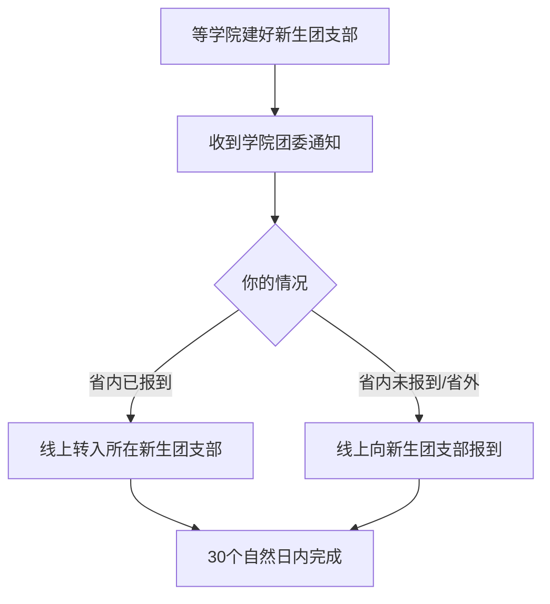

# 团组织关系转接

团关系走广东「智慧团建」系统。按团省委规定，升学毕业生的团关系暂时留在原学校，到新学校后 30 个自然日内转接完成。

## 学校的安排

- 8 月上旬：各学院在智慧团建里统一建好新生团支部。
- 8 月中旬：学院团委通知大家开始转接。

## 你要做的

| 你的情况 | 怎么操作 |
|---|---|
| 省内，已报到 | 线上转入所在的新生团支部 |
| 省内，未报到 / 省外 | 线上向所在的新生团支部「报到」 |

## 提醒

- 团支部没建好之前发起不了转接，等学院通知再操作。
- 超过 30 个自然日还没转，尽快联系学院团委。

## 相关公众号

「华南师大紫荆青年」——校团委官方号，智慧团建、i志愿入口都在这。

## 找谁问

学院团委；团支部书记
