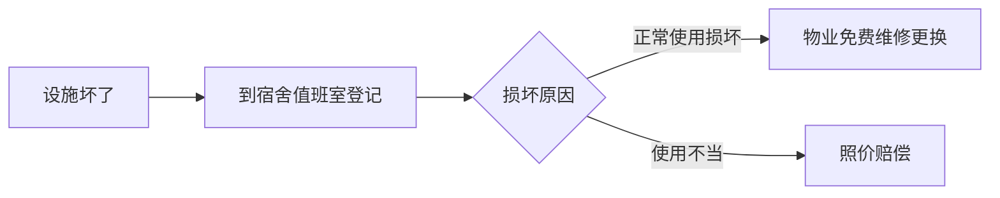
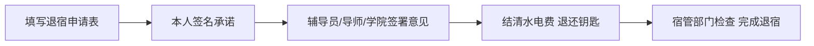

# 宿舍报修与退宿

水电、热水、报修、退宿与校外住宿都在这里。按学院与校区现行做法整理。

## 水电、热水与报修

### 水电费标准

| 项目 | 价格 |
|---|---|
| 电费 | 63.586875 分/千瓦时（约 0.636 元/度） |
| 水费 | 3.05 元/立方米（基本水价 1.85 + 污水处理费 1.20） |
| 热水 | 24.5 元/吨 |

查明细：微信搜「华南师范大学校园一卡通」小程序，或关注「华师后勤」公众号。

系统问题：17728045948；设备问题：18080048906。
后勤反馈：佛山校区管委会保障部，行政楼 225 室，0757-86687321。

### 热水供应时间

- 7:00-8:00
- 12:00-14:00
- 17:30-23:30

热水维修应急电话：0757-86687372。

### 桶装水

学校科技开发公司统一供应，自愿选择。订购电话 13226658820，或用「叮宝校园」小程序。

### 报修

设施坏了去宿舍值班室登记就行。正常使用的损耗由物业免费修，人为弄坏的要照价赔。

### 退宿

毕业或外宿需要退宿的，填退宿申请表，签字盖章后交后勤处。详见本专区「宿舍报修与退宿」（含退宿申请表下载）。校外住宿的申请表与办理说明待填写，见该文件夹「需要你填写」。

## 退宿与校外住宿

### 退宿

因为毕业、休学、入伍、交换、转专业，或住宿年限已满等原因要退宿的，填《退宿申请表》，签字盖章后交后勤处。

#### 哪些情况要附材料

- 休学、退学、转专业：不用学院审批，附学籍处理单即可
- 个人原因：辅导员审批时要向家长确认是否同意
- 住宿年限已满：不用审批，宿管部门直接处理

#### 怎么办

#### 注意

1. 承诺退宿后 **3 日内搬离**宿舍，保证设施完整，损坏照价赔偿，并结清水电费；之后学校有权清理床位物品。
2. 个人原因退宿，**每年只在 1 月、6 月受理**。
3. 表原件交校区宿管部门，自己留一份复印件，再交一份给辅导员备案。
4. 没办完退宿手续，仍算在校住宿，财务处会照常扣住宿费。

#### 相关文件内容

- [退宿申请表（2020 年起，签字盖章交后勤处）](<../08_文件专区/附件/02_申请表与审批表/退宿申请表（2020年起） 交后勤处.pdf>)
  - 表上要填个人信息、退宿宿舍、学生类型，以及退宿原因（退学、休学、入伍、交换学习、跨校区转专业、住宿年限已满、个人申请等）和退宿时间。
  - 申请人承诺一栏写明了 3 日内搬离、设施损坏照价赔偿、结清水电费，以及外宿责任由本人和家长承担。
  - 后面依次是辅导员意见、导师意见、院系意见，以及宿管检查记录、校区宿管部门处理记录。
  - 表格说明里写清：个人原因退宿只在 1 月、6 月受理；原件交宿管部门，复印件交辅导员备案；没办完手续仍算在校住宿，照常扣住宿费。

### 校外住宿

校外住宿的办理说明与申请表见下方「需要你填写」，填好后即可上线。

### 相关链接

- 公众号：华师后勤（宿舍报修、住宿服务）

## 找谁问

佛山校区管委会保障部 0757-86687321；宿舍值班室

## 需要你填写

- 校外住宿申请表（电科院版本）：【　】
- 办理流程与审批人：【　】
- 提交时间与地点：【　】
