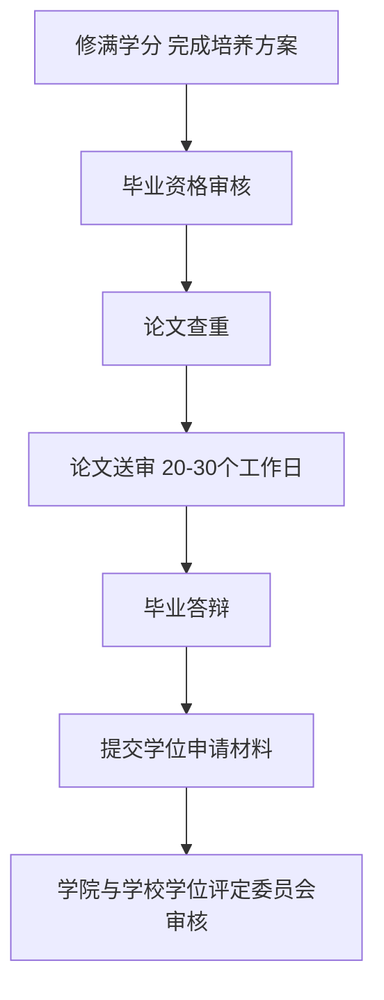
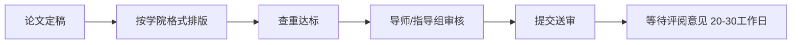
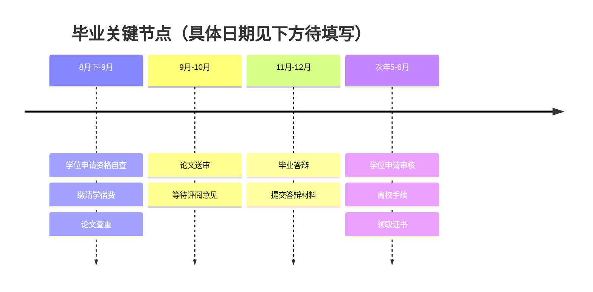

# 学位申请与论文送审

出口阶段的固定手续：资格审核 → 查重 → 送审 → 答辩 → 学位材料。培养环节（选题、开题、中期、毕业设计）见「在校学习专区 → 毕业设计」。按学院现行做法整理，具体日期见各节待填写项。

## 学位申请全流程

申请学位要先过毕业资格审核，再走查重、送审、答辩，最后提交学位申请材料。整个过程周期长，**论文送审要留够时间**。

### 整体流程

### 要准备的材料

| 材料 | 怎么弄 | 注意 |
|---|---|---|
| 学位论文（定稿） | 按学院格式排版 | 格式不符会被退回 |
| 查重报告 | 学院指定系统查重 | 送审前必须有 |
| 学位申请表 | 文件专区下载 | 导师和学院要签意见 |
| 毕业登记表 | 文件专区下载 | 逐项填，时间别留空档 |

### 各步骤要点

1. **毕业资格审核**：先确认学分修够、开题报告已上传、学宿费已缴清。有欠费的学校不给你审。
2. **论文查重**：送学院指定的系统，重复率要达标（一般不超过 20%）才能进送审。
3. **论文送审**：一般要 20–30 个工作日，**至少提前一个月**送，别卡着答辩时间。
4. **毕业答辩**：时间、地点、分组由学院统一发布。所有博士论文、重点关注论文都要预答辩。
5. **提交材料**：学院和学校学位评定委员会审核通过后，才算申请完成。

### 几个容易踩的坑

- 送审时间预留不够，影响答辩——务必提前。
- 论文格式被退回，尤其是参考文献格式，严格按学院模板来。
- 登记表经历时间断档，要连续填写。
- 有欠费、学分不够的，学校不受理学位申请。

## 论文送审

论文定稿、查重通过后才能送审。送审周期一般 20–30 个工作日，一定要提前安排。

### 送审前要完成的

### 要点

- **查重**：送审前必须通过学术不端检测，重复率原则上不超过 20%，由学院统一组织。
- **格式**：严格按学院学位论文撰写规范排版，格式不对会被退回修改。
- **时间**：送审要 20–30 个工作日，至少提前一个月提交。
- **评阅意见**：评审回来的意见要按导师和指导组要求认真修改，为答辩做好准备。

### 预答辩

以下论文送审前一般要先预答辩：
- 所有博士学位论文
- 重新申请答辩的论文
- 抽检有问题的导师指导的论文
- 导师或学院认为需要重点关注的论文

预答辩通过后才能安排送审。

### 容易踩的坑

- 卡着答辩时间才送审，评阅意见来不及返回。
- 查重没过就提交，直接被退回。
- 格式细节（参考文献、图表编号）出问题反复修改。

## 答辩安排

论文送审通过后安排毕业答辩。答辩时间、地点和分组由学院统一发布。

### 要说的事

- 答辩前按评阅意见修改论文，经导师和指导组同意后定稿。
- 答辩时间、地点、分组看学院通知。
- 答辩通过后按学院要求提交答辩材料（含毕业论文、答辩申请书等）PDF 版归档。

### 提醒

部分论文答辩前需要先通过预答辩（如所有博士论文、重点关注论文等）。

## 毕业流程时间线

毕业有一串环节，提前知道每个阶段大概什么时候做，才不会手忙脚乱。

### 大致节奏

> 上面只是大致节奏；具体日期按当年通知填到下面。本页按学院现行做法整理，与线上网站不一致时以本页为准。

### 贯穿全程的三件事

1. 学分修满、开题上传。
2. 学宿费缴清——欠费不给你毕业审核和答辩。
3. 论文按格式要求写、按时查重送审。

## 找谁问

研究生秘书（学位申请与送审）；导师（论文与答辩）

## 需要你填写

- 当年毕业资格审核 / 查重 / 送审 / 答辩的具体日期：【　】
- 学院指定的查重系统与重复率要求：【　】
- 当年送审起止时间与材料清单：【　】
- 答辩时间：【　】
- 答辩分组与地点：【　】
- 需提交的答辩材料清单：【　】
- 预答辩要求：【　】
- 资格自查 / 缴清学宿费 / 查重 日期：【　】
- 论文送审 / 评阅意见返回 日期：【　】
- 毕业答辩 / 提交材料 日期：【　】
- 学位审核 / 离校 / 领证 日期：【　】
