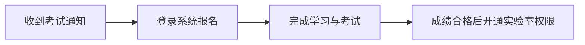

# 实验室安全考试

> 本页为占位骨架，流程细节待补充。以学院与学校实验室安全管理的现行要求为准。

## 考试对象

- 【　】（哪些年级、哪些专业、哪个时间点需要考）

## 考试入口

- 【　】（系统名称与网址）

## 考试流程

## 注意事项

- 【　】

## 找谁问

- 【　】

## 需要你填写

- 考试时间与截止时间：【　】
- 补考安排：【　】
- 未通过的后果：【　】
