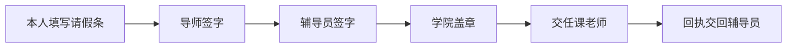
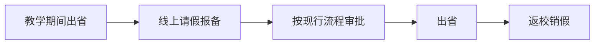

# 请假与考勤

请假分线下（纸质请假条）与线上（教学期间出省报备）两条线。教学期间出省都需要进行线上请假报备，这一条是硬性要求。按学院现行做法整理，线上网站旧说明不作为依据。

## 请假流程（线下 / 线上）

请假分两条线，先看清自己属于哪种：

| 情形 | 走哪条线 | 本页位置 |
|---|---|---|
| 一般病假、事假（纸质请假条） | **线下请假** | 一、线下请假 |
| **教学期间出省** | **线上请假报备**，必须办 | 二、线上请假 |
| 去校外实习、实践 | 校外学习实践审批 + 四方协议 | 「实习就业与毕业专区 → 实习申请与外出报备」 |

> **教学期间出省都需要进行线上请假报备**，这一条是硬性要求；线上请假的具体操作目前先留空，见下方「二、线上请假」的待填写项。

---

### 一、线下请假（纸质请假条）

本人先填表，按「导师 → 辅导员 → 盖章 → 任课老师」的顺序走完，最后把回执交回辅导员，才算办完。

#### 办理流程

#### 一步一步来

1. **填表**：下载下面的《请假条》，把请假时间、事由、课程都填清楚。
2. **导师签字**：先找导师签，再找辅导员——顺序不能反。
3. **学院盖章**：辅导员签完后到学院盖院章。
4. **告知任课老师**：把请假条拿给这学期的任课老师，说明缺课情况。
5. **交回执**：把请假条回执联交回辅导员备案。

#### 相关文件内容

- [请假条申请表（空表）](<请假条申请表（空表） 电院.doc>)
  - 表上要填姓名、性别、学号、年级、院（所）、专业、导师、联系电话，以及请假原因和时间。
  - 备注写清了审批权限：病假 2 周内、事假 1 周内由导师和学院研工办负责人同意；超过时限还要学院主管领导批准；一学期累计请假不能超过 1 个月。
  - 直接打印手写即可，签完按上面的流程走。

#### 几个要注意的地方

- 导师签字要在辅导员之前，先找辅导员会被退回来。
- 想用导师电子签名章的，得先得到导师同意，并提供证明材料。
- 请假批准后，记得自己主动告诉任课老师，别等老师发现你缺课。
- 一学期累计请假不能超过 1 个月，超了要办休学手续。
- 天数与审批级别的对照，见「在校学习专区 → 请假与考勤」。

---

### 二、线上请假（教学期间出省报备）

**教学期间出省都要进行线上请假报备**，不能只交纸质请假条。线上请假的入口、步骤和审批要求按学院现行做法执行，具体内容待填写。

> 线上请假的内容先留空：`【　】` 为待填写项，填完把括号删掉即可上线。

#### 办理流程（待填写）

#### 需要你填写

- 线上请假的系统 / 入口（网址、小程序或企业微信路径）：【　】
- 适用场景与判定口径（哪些情况算出省、教学期间怎么界定）：【　】
- 操作步骤（每一步点哪里、填什么）：【　】
- 要上传或提交的材料（行程、事由、证明等）：【　】
- 审批人与审批顺序：【　】
- 提前多久提交、审批时限：【　】
- 是否需要同时交纸质请假条 / 是否要销假：【　】
- 与「外出报备」如何区分、是否需要重复办理：【　】
- 违规未报备的处理说明：【　】
- 学院现行线上请假通知 / 操作截图（附件文件名与链接）：【　】

---

### 内容口径

以上流程按学院**现行做法**整理。线上网站若还留着旧的请假说明、与本页不一致，**以本页为准**。

### 相关文件内容

- [请假条申请表（空表）](<请假条申请表（空表） 电院.doc>)（线下请假用，见「一、线下请假」）

## 请假类型与天数规定

请假分病假和事假两种，天数不同，审批的人也不同。记住一条：**假越长，审批级别越高**。

### 天数与审批对照

| 请假类型 | 天数 | 谁来批 |
|---|---|---|
| 病假 | 两周以内 | 导师 + 学院研究生工作办公室负责人 |
| 病假 | 超过两周 | 上面两位 + 学院主管领导 |
| 事假 | 一周以内 | 导师 + 学院研究生工作办公室负责人 |
| 事假 | 超过一周 | 上面两位 + 学院主管领导 |

### 硬规定

- **一学期累计请假不得超过 1 个月**，超过就必须办休学手续。
- 请假获批准后，要主动把请假的事告诉相关任课老师。
- 请假条上的信息要如实填写，导师、辅导员的签字缺一不可。

### 什么时候用哪种

- 生病需要治疗、休养 → 病假（医院证明要求：【　】）
- 家里有事、个人事务需要离校 → 事假

## 销假与考勤异常处理

- 返校后是否要销假、找谁销假：【　】
- 考勤异常（缺课记录、系统未同步）怎么申诉：【　】
- 线上请假与纸质请假条是否需要同时提交：见上「请假流程（线下 / 线上）」中的待填写项。
