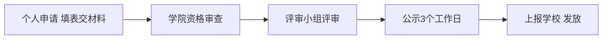

# 奖助学金

研究生奖助主要有学业奖学金、国家奖学金、国家助学金几种。评选一年一次，看上一学年的成绩和成果。

## 学业奖学金等级和金额

| 类别 | 等级 | 金额 | 比例 |
|---|---|---|---|
| 博士 | 一等 | 1.8 万元 | 20% |
| 博士 | 二等 | 1.5 万元 | 30% |
| 博士 | 三等 | 1 万元 | 50% |
| 硕士 | 一等 | 1 万元 | 10% |
| 硕士 | 二等 | 0.8 万元 | 30% |
| 硕士 | 三等 | 0.5 万元 | 60% |

> 具体标准以学校当年通知为准；当年通知文号与金额调整：【　】。

## 评选看什么

非一年级研究生的学业奖学金，按几部分打分：

| 部分 | 博士/国奖占比 | 硕士占比 |
|---|---|---|
| 思想品德 | 10% | 10% |
| 课业成绩 | 20% | 25% |
| 学术科研与实践 | 70% | 50% |
| 社会服务与实践 | — | 15% |

成果加分举几个常见的：
- 论文：顶尖层次 80+影响因子，一区/CCF A 50+影响因子，二区/CCF B 25+影响因子。论文单位必须是「华南师范大学」且为第一单位。
- 专利：受理加 5 分，授权加 10 分。
- 竞赛：国际/国家级一等奖 35 分，省级一等奖 16 分，校级一等奖 4 分。
- 志愿服务：i志愿每 1 小时 0.2 分，上限 10 分。

## 不能申请的情况

- 受刑事、行政处罚或纪律处分
- 材料有假信息或隐瞒
- 参评学年有课程不及格
- 学术不端、考试作弊
- 休学超过 6 个月
- 恶意欠缴学费、住宿费

## 评选流程

## 相关文件内容

- [研究生学业奖学金评分实施细则](<研究生学业奖学金评分实施细则 电院.docx>)
  - 学院 2025 年 12 月 15 日发布，替代此前相关细则，自发布之日起执行。
  - 写了评审原则、评审机构、评分模块和比例、论文/专利/竞赛等成果的计分办法、不能参评的情形，以及评审和公示流程。
  - 上面表格里的等级和比例只是概览，准备材料时以这份细则为准。
- [研究生国家助学金申请表](<研究生国家助学金申请表 电院.docx>)
  - 填基本情况、从大学开始的个人履历、档案是否调入我校、是否有固定工资收入，并签个人承诺；一式一份，学院存档备查。
- [个人所得税、社保缴纳记录查询步骤指引](<个人所得税、社保缴纳记录查询步骤指引 电院.pdf>)
  - 一步步教怎么在个税 APP 开纳税记录、在国家社会保险公共服务平台查社保并截图。
- [助学金材料示例与注意事项2026](<助学金材料示例与注意事项2026 电院.docx>)
  - 说明工资薪金和劳务报酬的区别、社保和养老保险记录怎么处理，以及天眼查、营业执照查询的要求。

助管报名表见「奖助专区 → 三助一辅岗位」；困难认定材料的详细提交要求见「奖助专区 → 家庭经济困难认定」。

## 国家助学金

硕士 6000 元/年，博士 13000 元/年。申请要交四项佐证材料（个税、社保、天眼查、营业执照查询），具体要求见家庭经济困难认定。

## 找谁问

学院研究生奖助优评审小组
