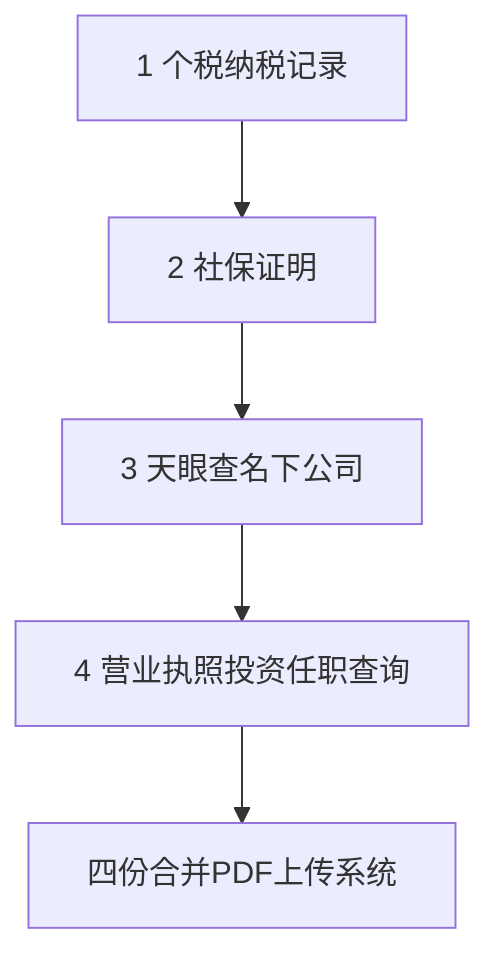

# 家庭经济困难认定（助学金佐证材料）

申请国家助学金要提供四项佐证材料，用来核实家庭经济情况。材料的准备有细节要求，做错了会被退回。

## 四项材料

## 一份一份说

**① 个税纳税记录**
用个税 APP → 纳税记录开具。
- 入学前可以有「工资薪金」记录；**入学后（9 月）到毕业期间不能有**。
- 实习、兼职收入算「劳务报酬」，可以有。
- 如果入学后有「工资薪金」，要在个税 APP 申诉改成「劳务报酬」。

**② 社保 / 养老保险**
- 粤省事小程序，或 https://si.12333.gov.cn/#/index 查询截图。
- 在读期间不能有养老保险、社保、职工医保记录。
- 有记录的要让单位及时撤销（一般 5 个工作日）。

**③ 天眼查**
查本人名下有没有公司。同名的话用身份证号核对是不是本人。

**④ 营业执照投资任职查询**
小程序「电子营业执照」→ 其他应用 → 投资任职情况查询。
> 查询时间限制在早上 6 点到晚上 8 点。

## 提交要求（容易出错）

1. 四份材料**各一页**，单面打印，共四页。
2. 每页空白处手写：「本人对此材料的真实性与有效性负责，如有违反，自愿承担相应的法律责任与纪律处分」+ 学号 + 专业 + 手机号 + 本人签字 + 日期。
3. 名字和身份证号要在截图里看得清，**不能打马赛克**。
4. 检索时间范围：2025 年 9 月 — 2026 年 8 月。
5. 四份合并成一个 PDF，在综合服务平台「智慧学工（二期）」填《研究生国家助学金申请表》并上传。
6. 系统提交后导出打印，**手写签字**（不能电子签、不能代签）。
7. 最终交五份：申请表 + 四份佐证材料，按顺序装订。

## 需要你填写

- 当年检索时间范围：【　】
- 当年提交系统与截止时间：【　】

## 相关文件内容

- [个人所得税、社保缴纳记录查询步骤指引](<个人所得税、社保缴纳记录查询步骤指引 电院.pdf>)
  - 个税 APP：首页「纳税记录开具」→ 选起止年月 → 滑块验证 → 生成纳税记录 → 预览或保存。老生查近半年，新生导出当年 9 月的。
  - 社保：登录 https://si.12333.gov.cn/#/index →「社保查询」→「个人参保证明查询打印」→ 选参保地查询并截图。
- [助学金材料示例与注意事项2026](<助学金材料示例与注意事项2026 电院.docx>)
  - 重点提醒：入学前可以有工资薪金，入学（9 月）后到毕业不能有；实习、兼职收入属于劳务报酬，可以有。
  - 入学后若有工资薪金记录，要在个税 APP 申诉为「劳务类」，不是撤销记录。
  - 在读期间不能有养老保险、社会保险或职工医保记录；实习单位误买工伤保险可以允许，但其他记录要及时让单位或社保局撤销。
  - 天眼查查本人名下公司，电子营业执照小程序查投资任职（查询时间 6:00—20:00）；个人信息被冒用开公司要向市场监管局报案。
- [研究生国家助学金申请表](<研究生国家助学金申请表 电院.docx>)
  - 表格含基本情况、从大学开始的个人履历、档案是否调入我校、是否有固定工资收入，以及本人承诺；一式一份，学院存档备查。

## 找谁问

研工办
