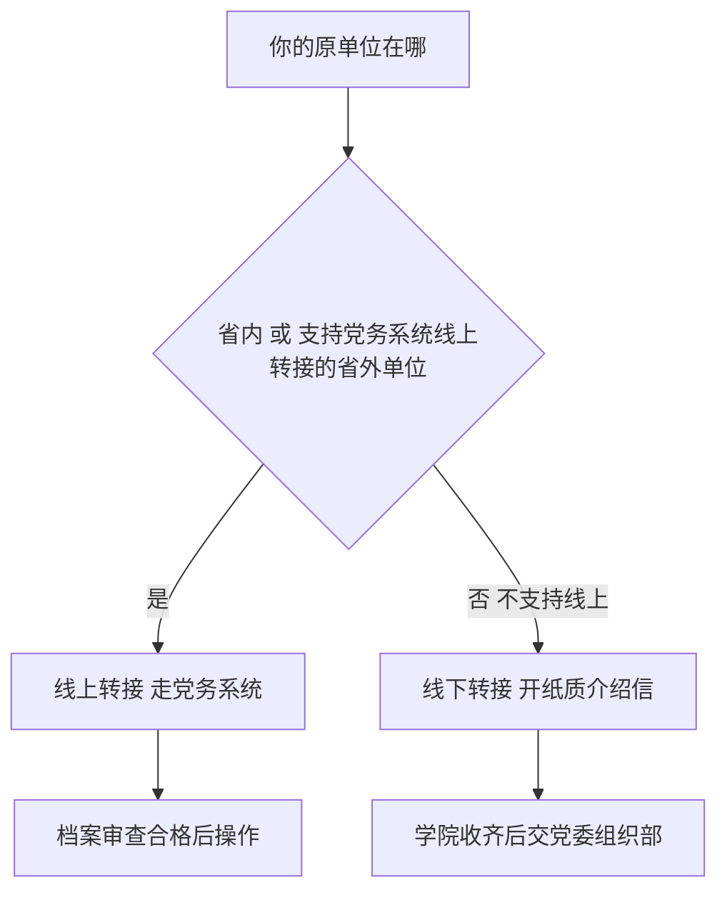

# 党组织关系转接

党员组织关系转入分线上、线下两种方式。省内和多数省外单位走党务系统线上转接；不能线上转的省外单位，开纸质介绍信线下办。

## 走哪种方式

## 线上转接：两种情况

先由原单位审查党员档案，合格后你再操作。

**转入二级党委**（比如文学院党委）
直接在系统里选对应的二级党委就行。
> 不用选「中共华南师范大学委员会」本身；如果下拉框里没有二级党委选项，说明你要去的是党总支或直属党支部，看下面这种情况。

**转入二级党总支或直属党支部**（比如国际文化学院党总支）
要先选「**中共华南师范大学委员会**」——因为党总支和直属党支部没有接收权，再由学校党委组织部转到你具体的总支/支部。
> 一定在**备注栏写明**转到哪个党总支的哪个支部，不写就转不到位。

**本院（电子科学与工程学院/微电子学院）在系统里选：「工学部党委」。**

其他研究院对应党委：

| 单位 | 选这个党委 |
|---|---|
| 电子科学与工程学院（微电子学院） | 工学部党委 |
| 科学技术与社会研究院 | 哲学与社会发展学院党委 |
| 脑科学与康复医学研究院 | 心理学院党委 |
| 量子物质研究院 | 物理学院党委 |
| 材料与新能源学院、数据科学与工程学院 | 汕尾校区党委 |

## 线下转接：介绍信怎么开

- 抬头写「**中共华南师范大学委员会**」，具体去向写「华南师范大学 XX 学院」。
- 以学院为单位收齐介绍信，由组织员（党务秘书）到学校党委组织部统一办理。
- 转入后学院在党务系统录入你的信息。
- 最后**自己把介绍信回执联寄回原党组织**，别漏。

## 找谁问

学院组织员（党务秘书）
