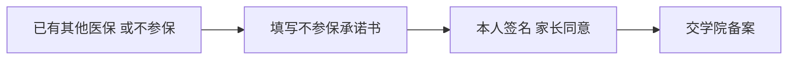

# 心理咨询与医保

医保参保、不参保与心理咨询预约。按学校与校区现行做法整理。

## 医保参保与不参保

学校统一代收代缴城乡居民医疗保险。默认参加；如果已经在别处参保，或不打算参保，要签一份《不参保承诺书》交给学院。

### 不参保怎么办

#### 承诺书要填什么

- 所在学院、学生姓名、身份证号、年级、联系电话
- 不参保原因（四选一）：
  1. 已在家里参加医保
  2. 已参加其他医保
  3. 不想参保
  4. 其他原因（写明具体原因）
- 学生本人签名、日期

#### 注意

- 签了不参保承诺书，就是确认**不同意参加本次本校统一代收代缴的城乡居民医疗保险，一切医疗费用自负**，且家长已同意。
- 签之前先想清楚，别随意签。

### 相关文件内容

- [不参保承诺书](<不参保承诺书.doc>)
  - 表格包含所在学院、学生姓名、身份证号、年级、联系电话。
  - 不参保原因四选一：已在家里参加医保 / 已参加其他医保 / 不想参保 / 其他原因（写明具体原因）。
  - 下面要学生本人签名、写日期；签了就表示不同意参加学校统一代收代缴的城乡居民医疗保险，医疗费用自负，且家长已同意。

### 相关链接

- 公众号：华南师范大学医院（医保查询、预约挂号）

## 心理咨询预约

- 预约方式（公众号 / 电话 / 企业微信）：【　】
- 咨询地点与开放时间：【　】
- 心理测评与心理健康活动安排：【　】
