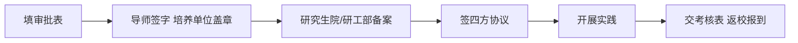

# 实习申请与外出报备

去校外实习、实践：出发前审批 → 签四方协议 → 实践 → 考核。教学期间出省另需线上请假报备。按学院现行做法整理。

## 实习申请与三张表

去校外实习、实践，按「出发前审批 → 签四方协议 → 实践 → 考核」走完。三张表都在本文件夹，直接下载填写。

### 三张表

| 表格 | 什么时候用 | 谁签字 |
|---|---|---|
| 校外学习实践审批表 | 出发前 | 本人 + 导师 + 培养单位盖章 |
| 学习实践四方协议书 | 出发前 | 实践单位、学校、导师、本人 |
| 校外学习实践考核表 | 实践结束后 | 实践单位评价、学院归档 |

### 相关文件内容

- [校外学习实践审批表](<校外学习实践审批表 电院.doc>)
  - 出发前填。表上要写本人信息、导师、家庭联系人、实践单位及详细地址、起止时间、实践计划。
  - 附有安全须知和声明，本人、导师、培养单位都要签字盖章；一式两份，个人和培养单位各留一份。一个学期多次外出，每次都要交。
- [学习实践四方协议书](<学习实践四方协议书 电院.doc>)
  - 甲方是实践单位，乙方是华南师范大学，丙方是校内导师，丁方是研究生。表里有填写说明：单位要写全称、盖单位公章，用黑色签字笔填，四方签字盖章后生效，一式四份。
- [校外学习实践考核表](<校外学习实践考核表 电院.doc>)
  - 实践结束后使用的考核表模板，用来记录实践单位对研究生的评价和考核意见，交学院归档。

### 办理流程

### 关键提醒

- 必须审批备案后才能出去，没审批自己出去，出事责任自负。
- 审批表一式两份，一个学期多次外出每次都要交。
- 四方协议用黑色签字笔填，一式四份，**不能复印**。
- 实践期间每周至少和导师、辅导员联系一次。
- 中途要离开或终止，提前 7 天申请。

## 教学期间出省与实践期间须知

### 教学期间出省

教学期间出省都需要进行**线上请假报备**。线上请假的入口、操作步骤和审批人见「在校学习专区 → 请假与考勤 → 线上请假」。

### 出了事怎么办

保持冷静，先采取有效措施，同时报告当地公安机关和学校。

## 找谁问

导师；学院研工办
