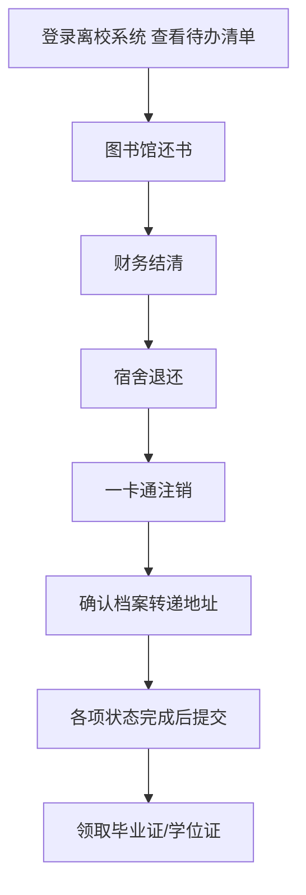

# 离校手续

学位通过后，要把离校系统里的各项事项逐条办完，才能领毕业证书和学位证书。

## 办理流程

## 要办的事项

离校系统会列出你个人需要办的事项，常见的有：

| 事项 | 去哪办 | 要求 |
|---|---|---|
| 图书归还 | 图书馆 | 无欠书、无欠费 |
| 财务结清 | 财务处 | 学宿费等结清 |
| 宿舍退还 | 宿管中心 | 退钥匙、清物品 |
| 一卡通注销 | 一卡通服务点 | 余额处理 |
| 档案转递 | 离校系统核对 | 确认接收地址 |

## 一步步来

1. 登录研究生系统里的离校模块，看清自己有哪些待办。
2. 逐项去办，每办完一项系统状态会更新。
3. 全部显示「已完成」后，提交离校登记表。
4. 按通知时间领取毕业证书和学位证书。

## 几个提醒

- 系统状态没更新，等 1 个工作日；还不更新就联系辅导员推动。
- 档案去向一定要在离校系统里核对清楚，填错地址很麻烦。
- 证书领取时间以学院通知为准，别错过。

## 找谁问

图书馆 / 财务 / 宿管 / 一卡通各归口部门
